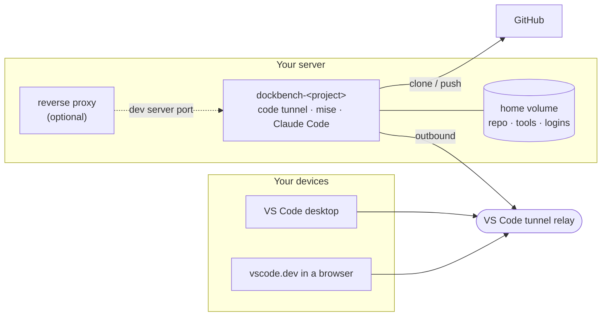

<div align="center">

# DockBench

**One Docker image that turns any GitHub repository into a remote dev environment on your own server.**

One container per project, reached through VS Code Remote Tunnels from the desktop app or any browser. No ports published, no SSH to expose.

[](https://github.com/Sander972/DockBench/actions/workflows/build.yml)
[](https://github.com/Sander972/DockBench/pkgs/container/dockbench)
[](#build-it-yourself)
[](LICENSE)

</div>

---

## Features

- **Zero exposed ports.** The VS Code tunnel is outbound only; you connect through `vscode.dev/tunnel/<name>` or the desktop app.
- **Batteries included.** Git, GitHub CLI, [mise](https://mise.jdx.dev), Python 3 (also as `python`), [Bun](https://bun.sh) and [rtk](https://github.com/rtk-ai/rtk) are preinstalled.
- **Per-project runtimes.** Each repo pins its own toolchain in a `.mise.toml` (Node, Go, Rust, Java, Deno, anything mise supports), plus an optional `.devcontainer/setup.sh` for apt packages.
- **Claude Code ready.** Installed into the home volume on first start and updated on every start, with your `~/.claude` config repo and its plugins synced automatically.
- **Persistent and idempotent.** The repo, tools and every login (GitHub, tunnel, Claude) live in one volume. Recreating the container never loses them.
- **Observable.** A small read-only `/status` JSON endpoint reports git state, tunnel state and the Claude Code setup, on the internal Docker network only.

## How it works



On every start the entrypoint, in order: installs or updates Claude Code, sets the git identity and GitHub credentials, overlays an optional `~/.claude` config repo and syncs its plugins, clones the repo on the first start, runs `mise install` and the optional setup script, starts the status server and finally execs `code tunnel`. Every optional step only warns on failure, so the tunnel always comes up and you can fix things from inside.

## Quick start

**1. Create the Docker networks** the containers join (once per server):

```sh
docker network create devnet
docker network create proxy   # or use your reverse proxy's existing external network
```

**2. Configure a project.** Copy [`.env.example`](.env.example) to `myapp.env` and fill it in:

```sh
PROJECT=myapp
REPO_URL=owner/myapp
GIT_USER_NAME=Your Name
GIT_USER_EMAIL=you@users.noreply.github.com
```

**3. Start it** with [`compose.yml`](compose.yml), or paste the same file as a Portainer stack:

```sh
docker compose -p myapp --env-file myapp.env up -d
docker logs -f dockbench-myapp
```

**4. Approve the device codes** printed in the log. Without `GITHUB_TOKEN`, `gh` first asks you to approve a code at `https://github.com/login/device` (git access); then the tunnel asks for a second one. Both happen once per project, the tokens persist in the volume.

**5. Open the workspace:**

| Client | URL |
|---|---|
| Desktop | `vscode://vscode-remote/tunnel+myapp/home/dev/workspace` |
| Browser | `https://vscode.dev/tunnel/myapp/home/dev/workspace` |

Both land directly in the cloned repo. Connecting through Remote Explorer instead opens an empty window: run `code ~/workspace` in its terminal. Then run `claude` in the terminal and log in once.

## Configuration

Every variable is listed in [`.env.example`](.env.example).

| Variable | Required | Meaning |
|---|---|---|
| `PROJECT` | yes | Container name suffix and tunnel name. Unique per GitHub account. |
| `REPO_URL` | yes | `owner/name` or a full https or ssh URL. Cloned into `/home/dev/workspace` on first start. |
| `GIT_USER_NAME`, `GIT_USER_EMAIL` | yes | Commit identity inside the container. |
| `GITHUB_TOKEN` | no | Fine-grained PAT scoped to that one repo (Contents read and write). Used by git through `gh` for clone, pull and push. Empty means the `gh` device-code login runs on first start. |
| `SSH_KEY` | no | Base64 of an OpenSSH private key for a deploy key on the repo. When present, `gh` is not logged in and `REPO_URL` should be `git@github.com:owner/name.git`. Written to `~/.ssh/id_ed25519` with a `.dockbench` marker; a later start without it deletes that marked key and repoints origin to `REPO_URL`. A key without the marker is never touched. |
| `INSTALL_CLAUDE` | no | `1` (default) installs Claude Code into `~/.local` on the first start and runs `claude update` on every later start, plus the VS Code extension `anthropic.claude-code`. It also pre-accepts Claude Code's trust prompt for `/home/dev/workspace` and installs and updates, in the background, the plugins `~/.claude/settings.json` enables (`enabledPlugins`, marketplaces from `extraKnownMarketplaces`); `/status` reports the progress. Claude Code's own background updater is off (`DISABLE_AUTOUPDATER=1`): the start is what updates it. `0` skips all of it; a Claude Code already in the volume stays. |
| `CLAUDE_CONFIG_REPO` | no | Git URL of a `~/.claude` config repo (skills, agents, hooks, settings). Fetched on every start and checked out over `~/.claude`: its tracked files win, credentials and history are kept. With `SSH_KEY` the deploy key cannot reach a second repo: use `git@github.com:owner/repo.git` plus `CLAUDE_CONFIG_KEY`, or `https://x-access-token:<read-only token>@github.com/owner/repo.git`. |
| `CLAUDE_CONFIG_KEY` | no | Base64 of an OpenSSH private key for a **read-only** deploy key on the config repo. Written to `~/.ssh/claude_config` and used only for the `CLAUDE_CONFIG_REPO` fetch; deleted (with its `.dockbench` marker) on a start where it is empty, only if the entrypoint wrote it. |
| `SETUP_RERUN` | no | `1` forces `.devcontainer/setup.sh` to run again on the next start. |
| `VSCODE_CONFIG` | no | `1` (default) seeds the VS Code Machine settings when `~/.vscode-server/data/Machine/settings.json` is missing or still identical to the image's `vscode/settings.json`. A file edited in the container is never overwritten. `0` skips it. |
| `VSCODE_SETTINGS` | no | Base64 of a VS Code `settings.json` used for that seed instead of the image's `vscode/settings.json`. Empty or invalid (logs a warning) seeds the image's file, which a later start with a valid value replaces. |

> [!TIP]
> Hooks in a `CLAUDE_CONFIG_REPO` run arbitrary commands in every container. Give the containers **read-only** access to it, so code running in one container cannot plant a hook that reaches all the others.

## Per-project runtimes

Commit a `.mise.toml` in the app repo:

```toml
[tools]
node = "22.11"
pnpm = "9"
```

`mise install` runs on every container start; a failure (a bad pin, an interrupted download) only logs a warning, so you can fix the file from inside and run `mise install` again. The image's Bun version is pinned by `BUN_VERSION` in the [`Dockerfile`](Dockerfile); pin `bun` in `.mise.toml` when a repo needs another one.

For apt packages or anything mise does not cover, commit `.devcontainer/setup.sh`. It runs with `sudo` available on the first start of every new container (first deploy, image update, redeploy), because a recreated container loses the packages it installed; plain restarts skip it. Keep it idempotent. A failing `setup.sh` logs a warning and runs again on the next start.

## VS Code settings and extensions

- [`vscode/settings.json`](vscode/settings.json) is copied into the container's Machine settings (the "Remote [Tunnel]" tab) on the first start, unless `VSCODE_SETTINGS` replaces it. Later starts leave a changed file alone. To reapply the image's version, delete `~/.vscode-server/data/Machine/settings.json` and restart.
- [`vscode/extensions.txt`](vscode/extensions.txt) lists one Marketplace id per line, preloaded into every container. A theme that does not ship with VS Code needs its id here.

Changing either one means rebuilding the image and recreating the containers. New extensions reach every container; a changed `settings.json` only reaches containers without Machine settings yet.

## Status API

`GET http://dockbench-<project>:8080/status` from any container on the same Docker network. Read-only, no auth, port never published.

```json
{
  "repo": "owner/name",
  "tunnel_name": "myapp",
  "branch": "main",
  "dirty": 3,
  "last_commit": {"sha": "abc1234", "message": "fix login", "date": "2026-10-13T10:22:00+02:00"},
  "ahead": 1,
  "behind": 0,
  "tunnel": "connected",
  "mise": {"node": "22.11.0"},
  "workspace_file": "myapp.code-workspace",
  "claude_installed": true,
  "claude_logged_in": true,
  "claude_version": "2.1.301",
  "claude_plugins": {"superpowers@claude-plugins-official": "6.4.1"},
  "claude_plugin_sync": {"state": "done", "at": "2026-10-15T22:24:51+00:00", "warnings": []},
  "uptime_seconds": 12345
}
```

<details>
<summary>Field reference</summary>

- `tunnel`: one of `connected`, `waiting_for_login`, `down`, `unknown`.
- `ahead`, `behind`: computed against the last fetch, never trigger one.
- `workspace_file`: bare name of the repo's root `*.code-workspace` (a regular file, not a symlink, with a printable name, first when sorted), or `null`.
- `claude_version`: name of the version folder `~/.local/bin/claude` links to, or `null`.
- `claude_plugins`: each installed plugin (`plugin@marketplace`) and its version, from `~/.claude/plugins/installed_plugins.json`.
- `claude_plugin_sync`: the background plugin sync of this start: `state` is `running` or `done`, `at` the time of that state, `warnings` the failures of the last run; `null` until the container's first sync starts.

</details>

## Testing your app from another device

Nothing is exposed by default. To reach a dev server from your phone, add a proxy host in your reverse proxy (for example nginx proxy manager on the `proxy` network): `myapp.dev.example.com` forwarding to `dockbench-myapp` on the dev server port, e.g. `5173`. Start the dev server bound to `0.0.0.0`, and put an access list in front of it if the app is not meant to be public.

## Updating

The image is rebuilt and pushed to `ghcr.io/sander972/dockbench` (`latest` plus a sha tag) on every push to `main`. Pull it and recreate the container (`docker compose -p myapp --env-file myapp.env up -d --pull always`, or "pull latest image" in Portainer). The volume keeps the repo, tools and all logins.

## Build it yourself

The published image is `linux/arm64`. For other architectures, or to customize it:

```sh
docker buildx build --platform linux/arm64 -t dockbench:arm64 --load .
docker buildx build --platform linux/amd64 -t dockbench:amd64 --load .
```

Then point `image:` in `compose.yml` at your tag. The included [GitHub Actions workflow](.github/workflows/build.yml) builds on a native arm64 runner (no QEMU) and pushes to your fork's GHCR.

## Security model

- **No published ports.** The tunnel is outbound only; both VS Code clients authenticate with your GitHub account through Microsoft's relay.
- **Status API on internal networks only.** It answers on every network the container joins, so it serves nothing secret: repo URL, branch, last commit subject and plugin list.
- **Unprivileged container.** Runs as uid 1000 without the Docker socket or extra capabilities. `sudo` exists only for setup scripts.
- **Narrow credentials.** Use a deploy key (`SSH_KEY`) or a fine-grained token scoped to one repo; it lives only in the stack environment and is rotated by editing it.
- **Blast radius of one project.** A mistake by Claude Code is contained to one project's container and volume.

## Development

```sh
mise install                       # shellcheck and hadolint, pinned in .mise.toml
python status_server.py --check    # self-check of the /status parsing
shellcheck entrypoint.sh
hadolint Dockerfile                # .hadolint.yaml lists the rules ignored on purpose
```

The entrypoint cannot run outside the image. To test one block, extract it with a `sed` range, point its paths at a temp dir with fixtures and run it under `bash -c "set -euo pipefail; ..."`. Every block must still reach the end: the entrypoint must always reach `exec code tunnel`, so a failure inside a block may only warn.

## Related projects

DockBench is the base image of a small toolkit. A web dashboard that deploys and monitors DockBench containers and a Telegram bot that drives Claude Code inside them are coming soon.

## License

[MIT](LICENSE)
