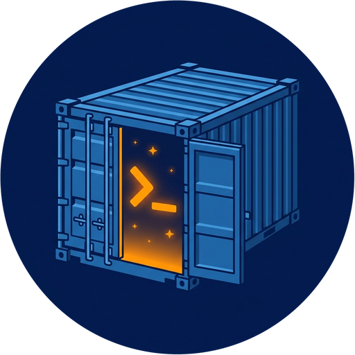
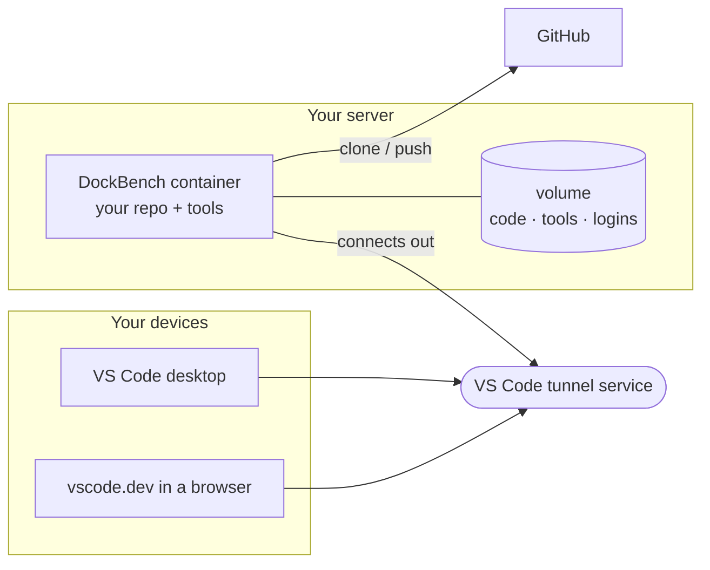

<div align="center">



# DockBench

**Your own cloud dev environment, on your own server.**

Point DockBench at a GitHub repository and get a ready-to-code workspace you can open in VS Code from any computer, or straight from a browser.

[](https://github.com/Sander972/DockBench/actions/workflows/build.yml)
[](https://github.com/Sander972/DockBench/pkgs/container/dockbench)
[](#build-it-yourself)
[](LICENSE)
<br>
[](https://github.com/Sander972/DockBench/commits/main)
[](https://github.com/Sander972/DockBench/issues)
[](https://github.com/Sander972/DockBench/stargazers)
[](#contributing)

[Getting started](#getting-started) · [Everyday use](#everyday-use) · [Configuration](#configuration) · [Security](#security)

</div>

---

## What is it for?

Think of it as a self-hosted GitHub Codespaces. You run one small Docker container per project on a server you own (a VPS, a home server, a 64-bit ARM board). The container clones your repository, installs the tools the project needs and connects to VS Code through a secure tunnel. You then code on that server from wherever you are:

- from **VS Code on your laptop**, as if the project were local;
- from **any browser** at `vscode.dev`, even on a tablet or a borrowed computer.

Your laptop stays clean, long builds and dev servers keep running when you close the lid, and every project lives in its own isolated box.

### Why you might like it

| | |
|---|---|
| 🔒 **Nothing exposed** | No open ports, no SSH, no VPN. The container dials out to VS Code's tunnel service; you sign in with GitHub. |
| 📦 **One project, one container** | Each repo gets its own environment and storage. Breaking one never touches the others. |
| ⚙️ **Tools set up for you** | Each repo lists its runtimes (Node, Python, Go, Rust, …) in a `.mise.toml` file, and they are installed automatically. |
| 💾 **Picks up where you left off** | Code, tools and logins live in a persistent volume. Restarts and image updates keep everything. |
| 🤖 **Ready for AI coding** | [Claude Code](https://claude.com/claude-code) is installed and kept up to date, so an AI agent can work inside a sandbox that only holds one project. |

### What's inside

Git, GitHub CLI, [mise](https://mise.jdx.dev) (installs per-project tools), Python 3, [Bun](https://bun.sh), [rtk](https://github.com/rtk-ai/rtk), the VS Code tunnel and, optionally, Claude Code.

## How it works



1. **You start a container** and tell it which repository to use.
2. **On its first start** it clones the repo, installs the project's tools and opens a tunnel.
3. **You open the tunnel** in VS Code or a browser and start coding. From then on it reconnects by itself.

## Getting started

**You need:** a 64-bit ARM Linux server with Docker and Docker Compose ([or build the image](#build-it-yourself) for x86), and a GitHub account.

### 1. Prepare the server (once)

The containers join two Docker networks. Create them:

```sh
docker network create devnet
docker network create proxy
```

`proxy` is where a reverse proxy can reach your dev servers later ([see below](#see-your-app-on-your-phone)). If your reverse proxy already has an external network with that name, skip it.

### 2. Describe your project

Download [`compose.yml`](compose.yml) and [`.env.example`](.env.example). Copy `.env.example` to `myapp.env` and fill in at least:

```sh
PROJECT=myapp                 # a short name: used for the container and the tunnel
REPO_URL=owner/myapp          # the GitHub repository to work on
GIT_USER_NAME=Your Name       # who your commits are from
GIT_USER_EMAIL=you@users.noreply.github.com
```

### 3. Start it

```sh
docker compose -p myapp --env-file myapp.env up -d
docker logs -f dockbench-myapp
```

Prefer a UI? Paste `compose.yml` as a Portainer stack and fill the same variables there.

### 4. Approve two sign-ins

The log shows two short codes, one after the other. Open the link shown (`https://github.com/login/device`) and enter each code:

1. the first gives the container **access to your repository**;
2. the second **connects the tunnel** to your GitHub account.

You do this only once per project. Setting `GITHUB_TOKEN` or `SSH_KEY` ([see Configuration](#configuration)) skips the first one.

### 5. Open your workspace

| From | Open |
|---|---|
| VS Code desktop | `vscode://vscode-remote/tunnel+myapp/home/dev/workspace` |
| Any browser | `https://vscode.dev/tunnel/myapp/home/dev/workspace` |

You land in your cloned repository with everything installed. To use Claude Code, run `claude` in the terminal and log in once.

> [!TIP]
> Opening the tunnel from VS Code's Remote Explorer shows an empty window. Run `code ~/workspace` in its terminal to open the repository.

## Everyday use

### Add the tools your project needs

Commit a `.mise.toml` to your repository:

```toml
[tools]
node = "22"
pnpm = "9"
```

They are installed on every start. Changed the file? Run `mise install` in the terminal. Any tool [mise supports](https://mise.jdx.dev/registry.html) works.

For system packages (`apt`) or anything else, commit an idempotent `.devcontainer/setup.sh`. It runs with `sudo` on the first start of each new container; set `SETUP_RERUN=1` to run it again.

### Start, stop, remove

```sh
docker compose -p myapp stop                              # pause, keeps everything
docker compose -p myapp --env-file myapp.env up -d        # start again
docker compose -p myapp down                              # remove the container, keep the volume
docker compose -p myapp down -v                           # remove everything, including code that is not pushed
```

More projects? One `.env` file and one `-p <name>` per project.

### Get updates

A new image is published on every change. Pull it and recreate the container; your volume keeps the code, tools and logins:

```sh
docker compose -p myapp --env-file myapp.env up -d --pull always
```

### See your app on your phone

Nothing is reachable from outside by default. To try a dev server on another device, start it on `0.0.0.0` and add a host in your reverse proxy (for example nginx proxy manager on the `proxy` network) that forwards `myapp.dev.example.com` to `dockbench-myapp` on the dev server port, e.g. `5173`. Protect it with an access list if the app is not meant to be public.

## Configuration

All settings are environment variables; [`.env.example`](.env.example) lists them.

| Variable | Required | What it does |
|---|---|---|
| `PROJECT` | yes | Container name suffix and tunnel name. Unique per GitHub account. |
| `REPO_URL` | yes | `owner/name` or a full https or ssh URL, cloned into `/home/dev/workspace` on first start. |
| `GIT_USER_NAME`, `GIT_USER_EMAIL` | yes | Commit identity inside the container. |
| `GITHUB_TOKEN` | no | Fine-grained token scoped to that one repo (Contents read and write). Skips the first sign-in code. |
| `SSH_KEY` | no | Base64 of an OpenSSH private key for a deploy key on the repo, as an alternative to `GITHUB_TOKEN`. Use an ssh `REPO_URL` (`git@github.com:owner/name.git`). |
| `INSTALL_CLAUDE` | no | `1` (default) installs and updates Claude Code; `0` skips it. |
| `CLAUDE_CONFIG_REPO` | no | Git URL of your `~/.claude` config repo (skills, agents, hooks, settings), applied on every start. |
| `CLAUDE_CONFIG_KEY` | no | Base64 of an OpenSSH private key for a **read-only** deploy key on that config repo. |
| `SETUP_RERUN` | no | `1` runs `.devcontainer/setup.sh` again on the next start. |
| `VSCODE_CONFIG` | no | `1` (default) applies the image's VS Code settings to a new container; `0` skips it. |
| `VSCODE_SETTINGS` | no | Base64 of your own VS Code `settings.json`, used instead of the image's. |

<details>
<summary><b>Details: credentials, Claude Code and VS Code settings</b></summary>

**`SSH_KEY`.** When set, `gh` is not logged in: git works, `gh pr` and `gh api` do not. The key is written to `~/.ssh/id_ed25519` with a `.dockbench` marker; a later start without it deletes that marked key and repoints `origin` to `REPO_URL`. A key without the marker is never touched.

**Claude Code.** With `INSTALL_CLAUDE=1` it is installed into `~/.local` on the first start and updated with `claude update` on every later one; its own background updater is off (`DISABLE_AUTOUPDATER=1`). The VS Code extension `anthropic.claude-code` is installed too, Claude Code's trust prompt for `/home/dev/workspace` is pre-accepted, and the plugins your `~/.claude/settings.json` enables (`enabledPlugins`, marketplaces from `extraKnownMarketplaces`) are installed and updated in the background, with progress in `/status`. With `0`, a Claude Code already in the volume stays.

**`CLAUDE_CONFIG_REPO`.** Fetched on every start and checked out over `~/.claude`: its tracked files win, credentials and history are kept. A deploy key from `SSH_KEY` cannot reach a second repo, so use `git@github.com:owner/repo.git` plus `CLAUDE_CONFIG_KEY`, or `https://x-access-token:<read-only token>@github.com/owner/repo.git`. Hooks in that repo run commands in every container, so give the containers **read-only** access to it.

**VS Code settings.** [`vscode/settings.json`](vscode/settings.json) is copied into the container's Machine settings (the "Remote [Tunnel]" tab) on the first start, or `VSCODE_SETTINGS` when it is valid base64. A file you edited in the container is never overwritten; delete `~/.vscode-server/data/Machine/settings.json` and restart to reapply. [`vscode/extensions.txt`](vscode/extensions.txt) lists the Marketplace extensions preloaded into every container.

**Failures never lock you out.** Every optional step (tool install, setup script, Claude Code, config repo) only logs a warning, so the tunnel always comes up and you can fix things from inside.

</details>

<details>
<summary><b>Status API</b></summary>

Each container serves a read-only JSON summary at `GET http://dockbench-<project>:8080/status`, reachable only from containers on the same Docker network (the port is never published). Handy for dashboards and monitoring.

```json
{
  "repo": "owner/name",
  "tunnel_name": "myapp",
  "branch": "main",
  "dirty": 3,
  "last_commit": {"sha": "abc1234", "message": "fix login", "date": "2026-10-13T10:22:00+02:00"},
  "ahead": 1,
  "behind": 0,
  "tunnel": "connected",
  "mise": {"node": "22.11.0"},
  "workspace_file": "myapp.code-workspace",
  "claude_installed": true,
  "claude_logged_in": true,
  "claude_version": "2.1.301",
  "claude_plugins": {"superpowers@claude-plugins-official": "6.4.1"},
  "claude_plugin_sync": {"state": "done", "at": "2026-10-15T22:24:51+00:00", "warnings": []},
  "uptime_seconds": 12345
}
```

- `tunnel`: `connected`, `waiting_for_login`, `down` or `unknown`.
- `ahead`, `behind`: against the last fetch; reading the status never fetches.
- `workspace_file`: name of the repo's root `*.code-workspace` file, or `null`.
- `claude_version`: installed Claude Code version, or `null`.
- `claude_plugins`: installed plugins (`plugin@marketplace`) and their versions.
- `claude_plugin_sync`: the background plugin sync of this start: `state` (`running` or `done`), `at`, and `warnings`; `null` before the first sync.

</details>

## Security

- **No published ports.** The tunnel only connects out; both VS Code clients authenticate with your GitHub account.
- **Unprivileged container.** Runs as an ordinary user, without the Docker socket or extra capabilities. `sudo` is there only for setup scripts.
- **Narrow credentials.** Prefer a deploy key or a token scoped to a single repository.
- **Contained mistakes.** Anything that goes wrong, including an AI agent's mistakes, stays inside one project's container and volume.
- **Status API is internal.** It answers only on the Docker networks the container joins and serves nothing secret.

## Build it yourself

The published image is `linux/arm64`. For x86 servers, or to customize it:

```sh
docker buildx build --platform linux/amd64 -t dockbench:amd64 --load .
```

Then set `image:` in `compose.yml` to your tag. The included [GitHub Actions workflow](.github/workflows/build.yml) builds on a native arm64 runner and pushes to your fork's GHCR.

## Contributing

Checks to run before a pull request:

```sh
mise install                       # shellcheck and hadolint, pinned in .mise.toml
cargo test --manifest-path agent/Cargo.toml   # dockbench-agent: /status logic and the bot probes (needs git)
shellcheck entrypoint.sh
hadolint Dockerfile                # .hadolint.yaml lists the rules ignored on purpose
```

The entrypoint must always reach the tunnel, so any step that can fail should warn and continue, never stop the start.

## Coming soon

DockBench is the base of a small toolkit: a web dashboard to deploy and monitor your containers, and a Telegram bot that drives Claude Code inside them.

## License

[MIT](LICENSE)
